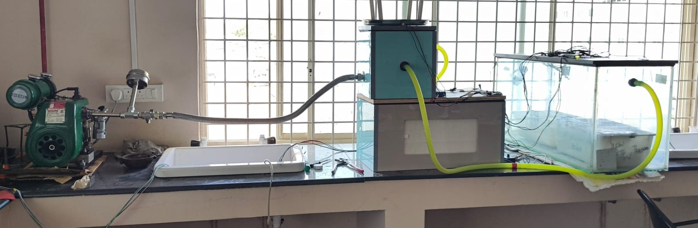
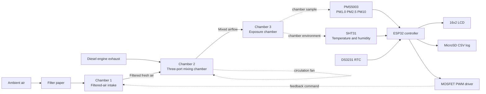
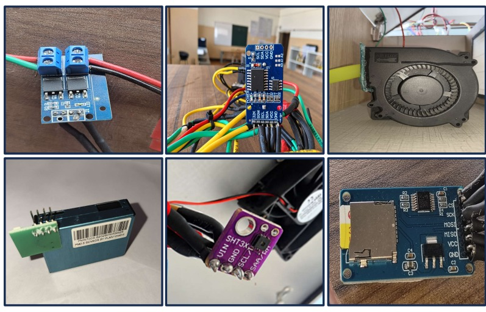
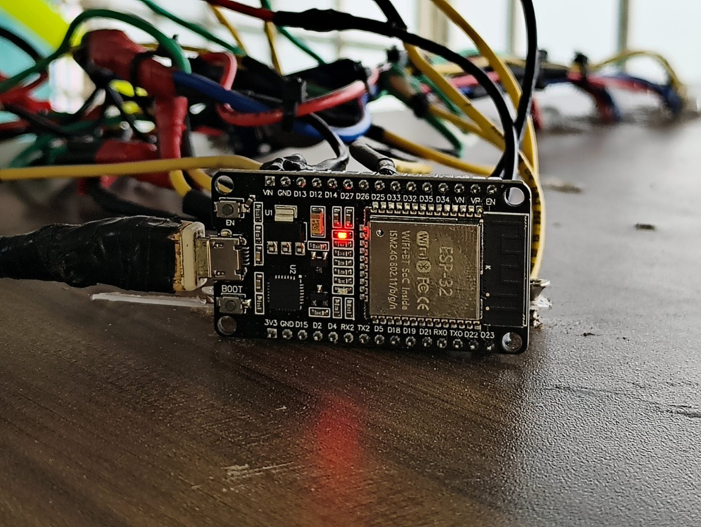
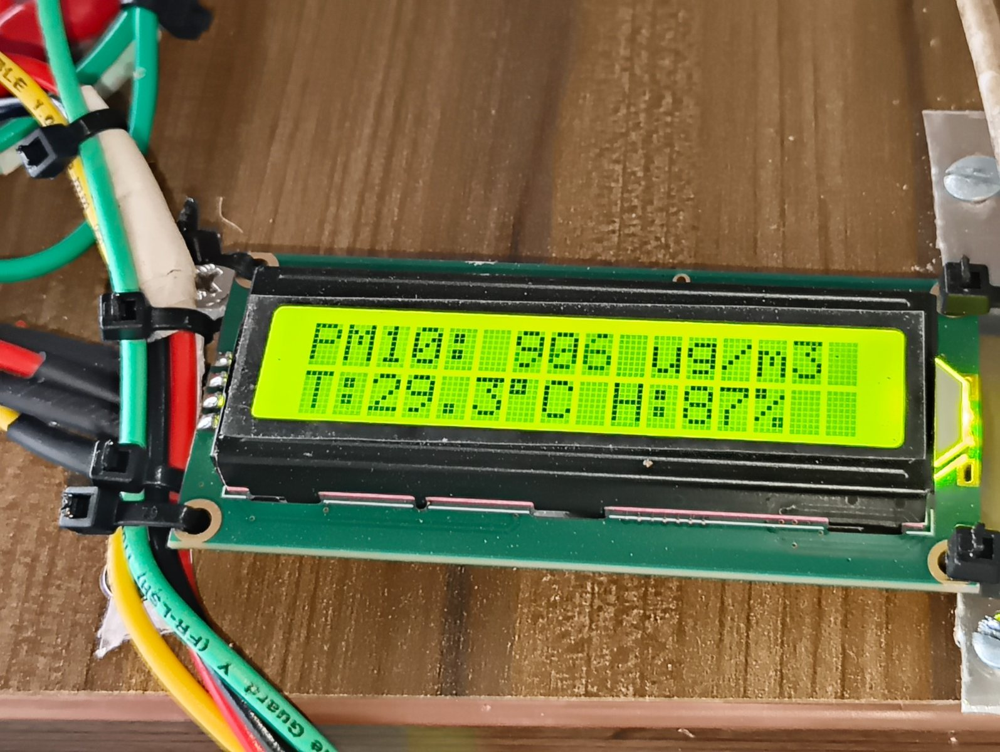
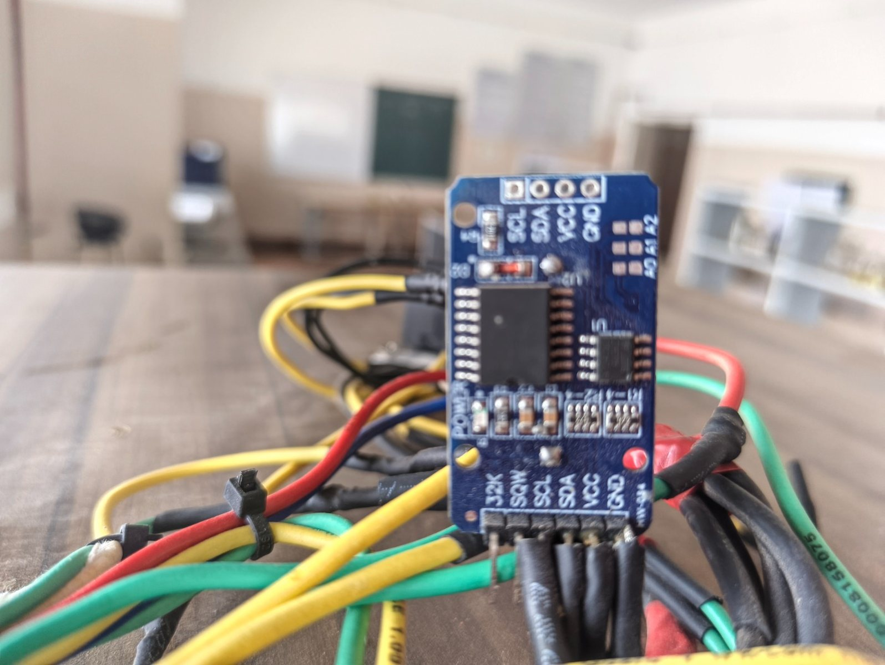
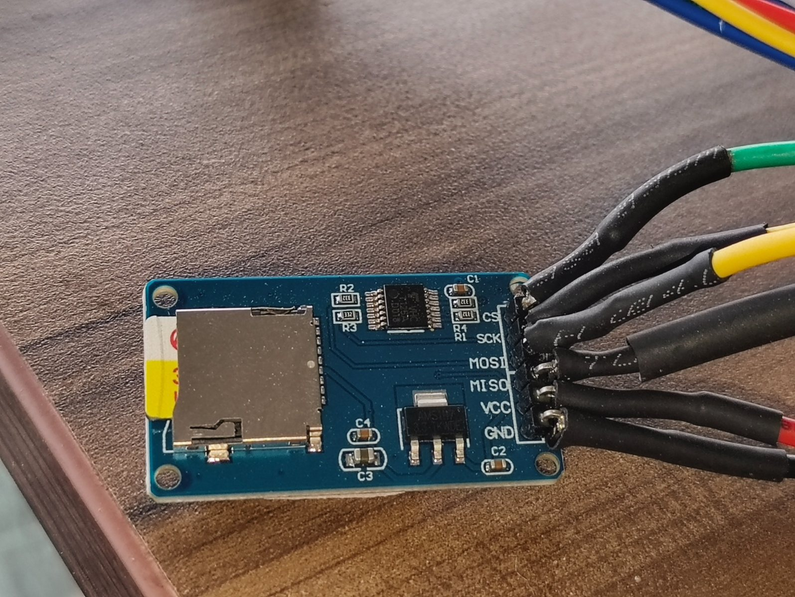

# ESP32 Urban Air Pollution Exposure Chamber Controller

An ESP32-based particulate-monitoring and airflow-control setup built to support a friend's M.Pharm research project. Filtered ambient air from Chamber 1 and diesel-engine exhaust enter Chamber 2, where a fan helps mix the streams. The mixed airflow then moves to Chamber 3 for exposure monitoring.

   



> My role: I am a 7th-semester Electronics and Communication Engineering student at East Point College of Engineering and Technology, Bengaluru. I helped a friend in M.Pharm automate the setup by completing electronics integration, ESP32 connections, wiring, the PWM blower interface, chamber interconnections, and electrical safeguards. My friend conducted the animal exposure and biological testing.

## My contribution

- Integrated the ESP32 with the PMS5003 particulate sensor, SHT31 temperature/humidity sensor, DS3231 real-time clock, 16x2 I2C LCD, and microSD module.
- Completed the ESP32-to-module signal wiring for UART, I2C, and SPI, and connected GPIO 25 PWM through the MOSFET blower driver.
- Connected the three chambers: filtered-air intake, exhaust/fresh-air mixing, and exposure monitoring.
- Completed the electronics and safety wiring for the assembled prototype. See the wiring guide for the pin map and recommended checks.
- Integrated the hardware with the single ESP32 sketch used by the prototype for particulate/environmental readings, LCD display, and timestamped SD-card logging.
- Handed the electronics subsystem to my friend for the research exposure and biological testing.

## System architecture



### How the system works

1. **Chamber 1 prepares the fresh-air stream.** Ambient air enters through filter paper. Its airflow is controlled by the PWM-driven blower connected through the MOSFET interface.
2. **The diesel engine provides the pollution stream.** Engine exhaust enters Chamber 2 through a separate inlet.
3. **Chamber 2 combines both inputs.** It has two inlets—diesel exhaust and filtered ambient air—and one outlet for the mixed stream. A fan in this chamber helps mix the gases.
4. **The mixed stream enters Chamber 3.** This is the controlled exposure chamber used by the collaborating researcher.
5. **Sensors measure Chamber 3 conditions.** The PMS5003 measures PM1.0, PM2.5, and PM10; the SHT31 measures temperature and relative humidity.
6. **The ESP32 processes and records the measurements.** It displays live values, adds the DS3231 timestamp, and stores a CSV record on the microSD card every two seconds.
7. **The particulate reading provides feedback for PWM airflow control.** The ESP32 applies the programmed blower command through the MOSFET driver. The threshold response is documented below as it appears in the supplied sketch; confirm it matches the intended filtered-air control before reuse.

The PMS5003 measures particulate concentration; it does not directly measure biological toxicity or diesel exhaust gases. PM concentration from Chamber 3 is the feedback variable used by the controller. See [docs/SYSTEM_ARCHITECTURE.md](docs/SYSTEM_ARCHITECTURE.md) for the full airflow, sensing, and control description.

## Hardware

| Component | Purpose |
|---|---|
| ESP32 development board | Main controller and data acquisition |
| PMS5003 particulate sensor | PM1.0, PM2.5, and PM10 measurement over UART |
| SHT31 sensor | Temperature and relative-humidity monitoring |
| DS3231 module | Date and time for each recorded sample |
| 16x2 I2C LCD | Local display of PM and environmental readings |
| MicroSD module | CSV data storage |
| MOSFET switching module | PWM interface between ESP32 and blower |
| Filter paper | Filters the ambient-air intake before Chamber 1 |
| PWM-driven blower | Moves filtered ambient air from Chamber 1 toward Chamber 2 |
| Chamber 2 fan | Mixes incoming filtered air and diesel exhaust before transfer to Chamber 3 |
| Chamber 1 | Filtered ambient-air intake and PWM airflow stage |
| Chamber 2 | Three-port diesel-exhaust and fresh-air mixing stage |
| Chamber 3 | Exposure, particulate sensing, and environmental monitoring stage |
| External load supply | Powers the blower at its rated voltage/current |

## ESP32 connections

| Function | ESP32 pin | Connected module |
|---|---:|---|
| I2C SDA | GPIO 21 | LCD SDA, SHT31 SDA, DS3231 SDA |
| I2C SCL | GPIO 22 | LCD SCL, SHT31 SCL, DS3231 SCL |
| PMS UART input | GPIO 16 / RX2 | PMS5003 TX |
| Fresh-air blower PWM control | GPIO 25 | MOSFET module control input |
| SPI SCK | GPIO 18 | MicroSD SCK |
| SPI MISO | GPIO 19 | MicroSD MISO |
| SPI MOSI | GPIO 23 | MicroSD MOSI |
| SD chip select | GPIO 5 | MicroSD CS |

See [docs/WIRING.md](docs/WIRING.md) for power, grounding, and protection notes. The wiring guide deliberately uses `V_BLOWER` because the exact supply must match the rating printed on the selected blower.

## Firmware behavior

The repository contains one sketch, copied from the supplied PM2.5-display program. It reads PM1.0, PM2.5, and PM10 from the PMS sensor, displays PM2.5 with temperature and humidity, applies its PM2.5 threshold profile to the PWM blower, and logs readings with RTC date/time to microSD every two seconds. The sketch replaces invalid PM and SHT31 readings with zero, so a zero in the log can indicate a sensor or frame problem rather than a confirmed zero concentration.

The supplied PM10-display program had the same PM2.5 blower thresholds and differed in which PM value it displayed. The repository keeps one representative sketch instead of duplicating nearly identical files.

### Prototype blower profile

| PM2.5 reading | Blower command in supplied sketch |
|---:|---:|
| Below 500 µg/m³ | 100% |
| 500-675 µg/m³ | 60% |
| 676-699 µg/m³ | 40% |
| 700 µg/m³ or above | 20% |

These bands came from the supplied sketch. Because the PWM blower supplies filtered fresh air, the programmed profile commands less airflow at higher PM2.5 readings. Confirm that this response and the MOSFET module polarity match the intended Chamber 3 control behavior before operating or reusing the system. The bands are prototype settings, not universal exposure limits or validated biological setpoints.

## Build requirements

- ESP32 board package for Arduino
- ESP32 Arduino core 3.x (`ledcAttach` / pin-based `ledcWrite` API)
- `LiquidCrystal_I2C`
- `Adafruit SHT31 Library`
- `RTClib`
- ESP32 `SD`, `SPI`, and `Wire` libraries

The sketch uses the PM2.5-display variant. The original PM10-display variant is not included because its control logic is otherwise the same. Verify the actual MOSFET/PWM polarity and intended airflow response before reuse.

## Example CSV schema

```text
Date,Time,PM1.0(ug/m3),PM2.5(ug/m3),PM10(ug/m3),Temperature(C),Humidity(%),Blower_Speed(%)
'2026-01-15','10:30:02',342,518,601,29.3,73,60%
```

The example demonstrates formatting only; it is not an experimental result.

## Repository structure

```text
urban-air-pollution-controller/
├── README.md
├── docs/
│   ├── SYSTEM_ARCHITECTURE.md
│   ├── WIRING.md
│   └── images/
└── firmware/
    └── air_quality_controller/
        └── air_quality_controller.ino
```

## Project status and limitations

- The original electronics were assembled and handed over as a working research prototype.
- The repository contains one source sketch copied from the supplied PM2.5-display program. I did not conduct the M.Pharm testing; my friend tested the research setup.
- Optical PM readings can be affected by humidity and aerosol composition. Chamber measurements require calibration and validation against the research method.
- Diesel exhaust can contain gases that the installed PMS5003 and SHT31 do not measure, including carbon monoxide, carbon dioxide, and nitrogen oxides. These variables require separate instrumentation if they are part of the approved study method.
- This repository does not contain animal data, biomarker results, histopathology, or claims about CYP1A2 effects.
- Operation in an animal study requires approval and supervision under the institution's applicable ethics and laboratory-safety procedures.

## Prototype photographs

### Electronics and sensors



### ESP32 controller



### Live LCD reading



### Timing and storage modules

| DS3231 real-time clock | MicroSD data logger |
|---|---|
|  |  |


