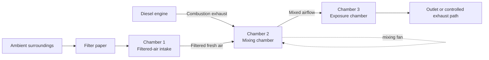
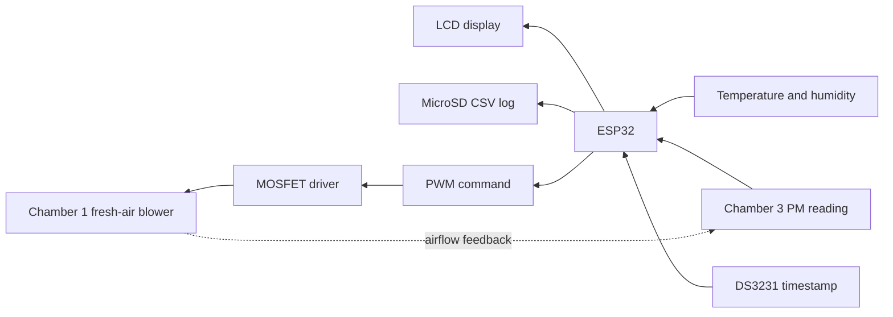

# Three Chamber System Architecture

## Purpose

The prototype routes filtered ambient air and diesel-engine exhaust through three chambers. The two streams meet in Chamber 2, where a fan mixes them before the combined airflow enters Chamber 3. Particulate concentration, temperature, and humidity are monitored in the exposure chamber.

## Airflow path

### Chamber 1 filtered-air stage

Chamber 1 receives air from the surrounding environment through filter paper. The filtered-air path continues to Chamber 2. A blower in this path is driven through a MOSFET by the ESP32 PWM output.

### Chamber 2 mixing stage

Chamber 2 has three principal airflow ports:

1. Diesel-engine exhaust inlet.
2. Filtered-air inlet from Chamber 1.
3. Mixed-stream outlet to Chamber 3.

The incoming combustion exhaust and filtered air are mixed in Chamber 2. A fan in this chamber supports mixing; the mixed stream exits through the third connection toward Chamber 3.

### Chamber 3 exposure and measurement stage

The mixed stream enters Chamber 3, which is used by the collaborating M.Pharm researcher for the approved exposure procedure. Instrumentation associated with this stage includes:

- PMS5003 for PM1.0, PM2.5, and PM10 mass-concentration readings.
- SHT31 for temperature and relative humidity.
- ESP32 for acquisition and control processing.
- 16x2 LCD for live values.
- DS3231 real-time clock for timestamps.
- MicroSD module for CSV data logging.

## Control and data flow

The supplied sketch samples every two seconds. The PMS5003 frame supplies PM1.0, PM2.5, and PM10 readings, while the SHT31 supplies temperature and relative humidity. The PM2.5-display sketch uses PM2.5 to select the stepwise PWM command, displays PM2.5 and environmental readings on the LCD, and records the values with the DS3231 timestamp on the microSD card. The alternate supplied sketch changed the displayed PM fraction to PM10 while retaining the PM2.5-based blower thresholds; only one representative sketch is included in this repository.

The supplied thresholds command 100% blower below 500 µg/m³, then 60%, 40%, and 20% as PM2.5 rises across the configured bands. Since the blower is described as supplying filtered ambient air from Chamber 1, this response reduces the fresh-air command as PM rises. Verify the intended control direction and the MOSFET module's polarity before relying on this profile.

## Measurement boundary

The installed PMS5003 measures particulate mass concentration; it does not directly measure toxicity or identify the chemical composition of the exhaust. The SHT31 measures only temperature and relative humidity. Diesel-exhaust gases such as carbon monoxide, carbon dioxide, and nitrogen oxides are outside the measurement capability of the documented prototype and would require separate sensors and validation.

The displayed thresholds are prototype configuration values rather than universal exposure or safety limits. Any reuse requires verification of chamber airflow, PWM polarity, sensor calibration, study requirements, and applicable laboratory and ethics approvals.

